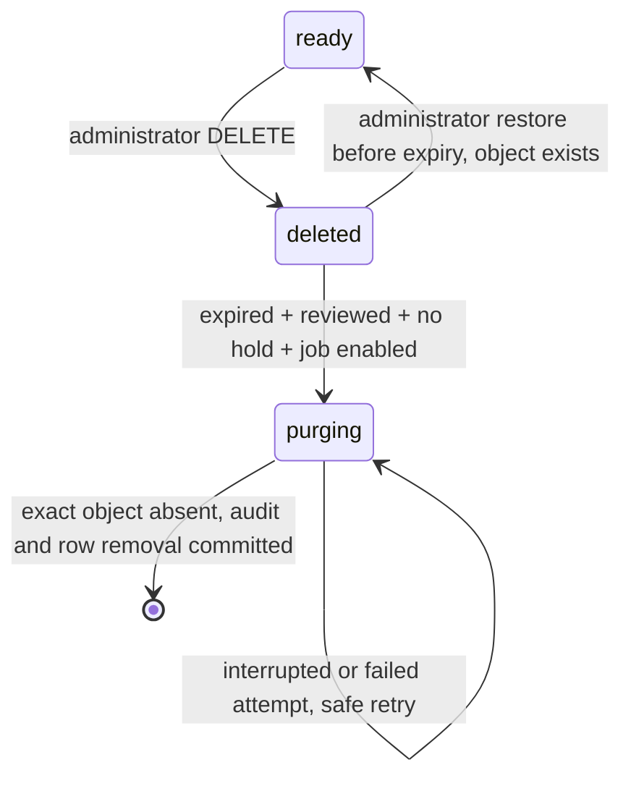

# Photo retention, restoration and purge operations

## Lifecycle and production safeguards

PostgreSQL is authoritative. Existing photos keep their data and API states:
`ready` (active), `deleted` (soft-deleted), plus the new durable `purging` state.
Successful permanent deletion removes the photo row, representing PURGED. No
complete metadata tombstone is retained: audit events already preserve the photo
ID, instrument ID, UTC timestamp and relevant actor/execution UUID without any
foreign key requiring the photo row to remain. Original filename, hold reason,
object key, upload attribution and other photo metadata disappear with the row.



`pending` upload reservations remain separate and are still handled exclusively
by `atelier-photos-cleanup`. This feature changes neither the image encoding
pipeline nor its quality settings. It creates no variants, copies or new prefixes.
Never enable broad R2 lifecycle expiration on `instruments/`: R2 object age cannot
determine documentation retention, deletion eligibility or active status.

| Setting | Default | Validation / purpose |
|---|---|---|
| `PHOTO_SOFT_DELETE_RETENTION_DAYS` | `30` | Integer 1–36500; operational recovery window |
| `PHOTO_AUTO_PURGE_ENABLED` | `false` | Explicit activation for destructive CLI runs |

The window runs from `deletion_requested_at`, the existing UTC soft-deletion
timestamp, never from upload time. At exactly deletion time + retention days the
photo is expired. Repeated DELETE retains its original timestamp and audit event.
Changing retention changes eligibility of unclaimed deleted photos, including
existing rows; assess a dry-run before shortening it. An already committed purge
claim remains irreversible and can be reconciled even if retention is lengthened.
Turning the activation switch off prevents new CLI invocations from deleting or
reconciling objects, but does not cancel an already running job. Stop the scheduler
and wait for running jobs before changing operational policy or deploying a rollback.

**The default 30 days is not a legal retention requirement.** Permanent deletion
requires both the global activation switch and explicit approval of each
soft-deleted photo. Existing/migrated and newly uploaded photos are unapproved.
The application has no reliable relationship linking a photo to every repair,
contract, dispute or document obligation. Administrators must review these needs
and create holds; enabling the global switch alone never makes unreviewed photos
eligible. Never infer that an absent application relationship means no obligation.

## Administrator APIs

All paths below `/api/v1/instruments/{instrument_id}/photos/{photo_id}` reuse
session authentication, staff protection and CSRF; only administrators may use
them. Employees/customers cannot restore, approve or manage holds. There is no
HTTP permanent-deletion endpoint. Normal listing/content/download continue to
return active photos only. Private responses are not cached.

- `POST /restore`: within the recovery window, confirm the exact R2 object exists,
  then atomically change `deleted` to `ready`, clear deletion and purge approval,
  and record restoration. Active, expired or purging photos return 409. Missing
  photo/wrong instrument/already purged return 404. Missing object is 409; storage
  failure 503. Restore never recreates a missing object. A hold survives restoration.
- `GET /retention`: inspect status, current hold and purge approval, including
  soft-deleted or purging photos. It reveals no object key or bucket details.
- `POST /retention-hold` with `{"reason":"Approved documentation need"}`: protect
  an active or deleted photo. Trimmed, nonblank reason is limited to 500 characters.
  Record reason, UTC creation time and administrator reference. Avoid unnecessary
  personal information. Repeating the same hold is idempotent; replacing a reason
  requires explicit release first. Hold creation clears any purge approval.
- `DELETE /retention-hold`: explicitly release the hold, record its audit event,
  clear hold metadata and purge approval. Repetition is idempotent. Holds never
  silently expire. Audit retains release/creation time and actor, but not the reason.
- `POST /purge-approval` with `{"confirm_no_retention_requirements":true}`: confirm
  that other business/legal documentation requirements were reviewed. Only deleted
  photos without a hold can be approved; repetitions are idempotent. Approval does
  not shorten recovery and does not delete an object. Releasing a hold is not
  approval; a new review is required. Restore/new deletion also requires new approval.

Purging photos reject restoration, DELETE, hold changes and approval changes with
409. Approval/hold operations and purge claiming lock the same PostgreSQL photo
row, so a newly committed hold cannot be bypassed by a stale eligibility query.
Holding a photo prevents purge even after the recovery window, but does not extend
the restoration window or make deleted content available to ordinary endpoints.
The administrator must keep the photo ID (DELETE response/audit) to inspect its
retention state; no deleted-photo browsing UI is introduced.

## Dedicated batch command and dry-run

```bash
uv run atelier-photos-purge --dry-run
uv run atelier-photos-purge --dry-run --limit 100
# Only after approval, correct configuration and smoke testing:
uv run atelier-photos-purge --limit 100
```

The limit defaults to 100 and accepts 1–1000. Processing and R2 calls are sequential
and bounded. Dry-run aggregates all eligibility statistics without table-wide
Python materialization; limit governs destructive batch selection, not aggregate
counts. It never creates claims, changes timestamps, appends audits or contacts R2.
It works while auto-purge is disabled. Without R2 configuration it reports
**potential** eligibility across storage locations (`storage_configured=false`);
it cannot verify the target bucket. A configured dry-run reports that exact
namespace, without revealing credentials. Ordinary dry-run is safe in production.

The single JSON summary contains execution UUID, result, dry-run/storage flags,
eligible count/bytes, active/young/unreviewed/protected counts, interrupted claims,
invalid identities/wrong storage locations, processed/purged/skipped/failed counts,
recovered claims, estimated bytes freed and duration. `protected` counts expired
soft-deleted photos with active holds; `skipped` counts selection/lock races.
Counts are a point-in-time preview and may change under concurrent operations.
A job can select already locked candidates and safely skip them; the next run can
process remaining backlog. Limit caps selected candidates, including recovered
claims, rather than guaranteeing that many successful deletions.

Nonzero exit means disabled destructive execution, invalid arguments, unavailable
configuration/database/storage, invalid identity/location, or failed attempts.
Storage failures are independent: one failed photo does not hide later work.
Unexpected errors are not silently treated as successful deletion. No infinite
retry loop exists: one attempt per selected photo per invocation, plus the existing
bounded SDK retries. Persistent failures remain visible in logs and require review.

## Coordination and interrupted jobs

The job selects expired, approved, unheld rows plus prior interrupted `purging`
claims. It verifies both storage namespace and the exact key shape:
`instruments/{immutable_instrument_uuid}/{photo_uuid_v4}.{verified_extension}`.
It never uses filenames, deletes a prefix or infers eligibility from R2 listing.
Invalid identities or wrong storage locations fail safely without deletion.

For each photo, a dedicated PostgreSQL connection acquires a session advisory lock;
a short row-lock transaction rechecks eligibility and commits `purging` plus the
start audit event **before** contacting R2. The transaction ends before network
I/O; the connection and advisory lock remain owned until finalization. Multiple
workers safely skip a photo already being processed. A crashed/disconnected worker
releases its session lock; the durable claim remains. The next worker can reclaim
it without a lease or transitioning back to a restorable state.

**Use a direct PostgreSQL endpoint for this job.** Neon `-pooler` URLs are rejected.
Session advisory locks are incompatible with transaction-pooling proxies; a custom
proxy cannot reliably be detected, so operators must verify direct/session-bound
connections. See [PostgreSQL advisory locks](https://www.postgresql.org/docs/current/explicit-locking.html#ADVISORY-LOCKS).
Restore performs HEAD outside a transaction and rechecks state under a row lock
before updating. If a purge claimed the photo in between, restoration fails.
Conversely, a restore or hold that commits before claiming makes the candidate
ineligible. No Python lock coordinates production workers.

After an authorized exact-key delete, HEAD must confirm absence before the job
records completion and removes the row atomically. A preexisting missing object
can thus be reconciled safely. R2 delete/HEAD errors never mark success, including
permission errors; the storage adapter treats only a genuine 404 as absence.
A completed delete followed by failed database finalization leaves the durable
claim. Later retry repeats exact-key deletion and confirms absence, then finishes.
The [R2 consistency model](https://developers.cloudflare.com/r2/reference/consistency/)
supports immediate observation of deletes. No distributed transaction is claimed.

Purge-start is recorded once per lifecycle. A failed attempt has a failure audit
with its job UUID; retries do not repeat the start event. Completion audit and row
removal commit together, so only one completion survives. Scheduled actions have
no interactive actor; administrator actions retain their actor. Logs/audits omit
filenames, hold reasons, contents, signed URLs, tokens and infrastructure credentials.
Database administrators/storage administrators can bypass application safeguards;
this is not tamper-proof evidence storage. A connection loss can cause idempotent
exact-key deletion to be retried; no new object may reuse a purging key.

## Render Cron Job and production activation

No infrastructure or production job is provisioned or enabled by this change.

1. Approve recovery policy, hold management, erasure obligations, backup retention
   and authority to approve individual photos. Preserve evidence under holds.
2. Deploy schema migration `uv run alembic upgrade head`, then the application.
   Migration `0a8d39e71b56` preserves existing photo data, adds nullable safeguard
   columns and an eligibility index, and extends status/deletion constraints.
3. Keep `PHOTO_AUTO_PURGE_ENABLED=false`. Use the direct production Neon
   `DATABASE_URL`, production settings and private `atelier-api-prod` bucket with
   its own scoped R2 endpoint/access key/secret. Share appropriate Render secret
   environment groups; never paste credentials into commands or logs.
4. Run dry-run, review held/unreviewed/expired counts and namespace errors, and
   complete real-bucket failure/retry smoke tests in `atelier-api-dev` first.
5. Review photos individually; set holds or approve deletion. Require organizational
   sign-off before setting `PHOTO_AUTO_PURGE_ENABLED=true` for the cron environment.
6. Create a Render Cron Job with the existing repository/build setup, dependencies
   installed via `uv sync --locked`, schedule `0 3 * * *`, and command
   `uv run atelier-photos-purge --limit 100`. Render schedules are **UTC**: 03:00 UTC
   is 04:00 in Berlin winter and 05:00 in summer. The regular API service need not
   enable auto-purge just to support restoration/holds/approval.
7. Inspect the Runs page, exit code and JSON result/UUID. Alert on nonzero exit,
   failures, stale claims, wrong namespaces and an increasing eligible backlog.
   Retry on the next scheduled run or trigger a reviewed manual run. Do not assume
   the scheduler automatically retries failures immediately. Render manual triggers
   may cancel an active run; durable claims support recovery. See
   [Render Cron Jobs](https://render.com/docs/cronjobs).
8. Disable by setting the cron environment switch to false and suspending/stopping
   the job; wait for active work to stop. Reconcile in-progress claims before an
   application rollback. Do not run older code against unresolved `purging` rows.

Downgrade is supported when no purging rows or active holds remain; it refuses to
silently discard uncertain deletions or hold information. Export/review protections
and drain claims before any downgrade. Never use downtime rollback as a reason to
clear an uncertain claim to `deleted` manually.

Successful purge actually removes the exact object from the configured R2 bucket;
it does not merely hide metadata or move it to another prefix. This reduces bytes
stored, but actual charges depend on R2 storage class, operations, retention and
billing rules. Independently retained backups or exported copies are outside this
job's scope and need their own approved erasure/recovery policy. A database restore
alone cannot recover purged images: coordinate object and PostgreSQL backups and
review restored claims/approvals before restarting purge. Use a separate storage
namespace for drills or cloned databases.

## Verification and remaining decisions

Automated tests use fake storage and PostgreSQL, including parallel workers,
restore/hold races, no database transaction during storage I/O, stale-claim recovery,
missing objects, storage failures and database-finalization failure. They delete no
real R2 objects. Run the existing full quality suite, build/installation checks and
Alembic consistency/round-trip checks before deployment.

Real R2 integration remains a manual development-bucket check: upload a disposable
photo, soft-delete and restore it, add/release a hold, approve an expired test
photo, dry-run, enable only that isolated job and verify the exact object is absent
after purge. Verify retry after injected development-only failure. Never shorten
production retention or alter real evidence timestamps for a smoke test.

No statutory duration, automatic inference of contractual obligations or production
activation is supplied. Policy approval, per-photo review ownership, alerts, cron
capacity/schedule, backup erasure and recovery procedures remain operational/business
decisions. Recovery ends at expiry even if auto-purge is disabled or a hold exists;
keep required documentation active instead of using deleted photos as an archive.
